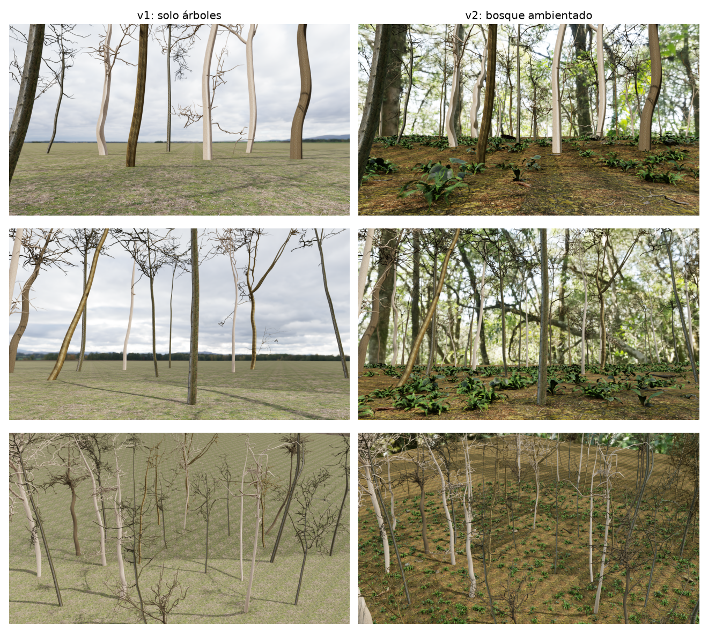
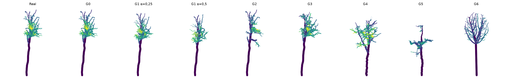
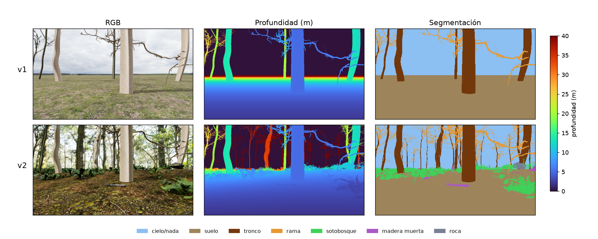

# Synthetic_Tree_G

**Generación de árboles tropicales sintéticos a partir de modelos QSM reales, y bosque virtual con LiDAR y cámara de profundidad en NVIDIA Isaac Sim.**

*Generating synthetic tropical trees from real QSM tree models, with a virtual forest for LiDAR and depth-camera simulation in NVIDIA Isaac Sim.*

**Autores:** Nelson Broyer-Paco, Angel Marquez-Aguilar, Li Shi, Josine, Pacifique

📄 Artículo: [`paper/main.pdf`](paper/main.pdf) (en español) · 📦 Datos pesados (grabaciones, videos, escenas): [Google Drive](https://drive.google.com/drive/folders/1A_rpW5E1f6_VL9n4JmHMmiPmwXZPpeNK?usp=sharing)



---

## Resumen

Las redes que segmentan nubes de puntos de bosques necesitan muchos datos etiquetados, y etiquetarlos es caro. Este proyecto estudia **cómo generar árboles sintéticos realistas a partir de árboles reales escaneados** y **cómo medir si se parecen a los reales**. Después los usa para construir un bosque virtual con sensores simulados.

1. **Datos reales:** 201 QSM (modelos de cilindros reconstruidos con TreeQSM) de árboles tropicales de 53 especies de Barro Colorado Island, Panamá ([Krishna Moorthy et al. 2022](https://doi.org/10.5281/zenodo.6981485), CC BY 4.0). Se separan por árbol en 152 de entrenamiento y 49 de prueba.
2. **Ocho generadores** que cubren las tres familias de la literatura:

   | Familia | Generadores |
   |---|---|
   | Aprenden de árboles reales | **G0** ruido de radio · **G1** perturbación alométrica · **G2** recombinación de ramas de la misma especie · **G3** híbrido · **G4** procedural que sortea reglas de ramas reales |
   | Reglas botánicas | **G5** alometría, filotaxis, perfiles medios |
   | Algoritmo de crecimiento | **G6** *space colonization* |

3. **Evaluación frente a árboles reales no vistos**, siempre con la referencia de la variabilidad real–real:
   - fidelidad: Wasserstein normalizada sobre 22 rasgos de árbol y 10 de rama, y test 1-NNA;
   - novedad: ¿es un árbol nuevo o una copia?;
   - validez botánica.
4. **Bosque virtual en Isaac Sim 6.2** con la mejor mezcla (G2 + G4) y ramas modeladas como tubos continuos, en dos versiones con los mismos árboles y el mismo recorrido:
   - **v1:** solo árboles;
   - **v2:** bosque ambientado, con terreno, sotobosque, madera muerta, rocas y anillo exterior de árboles.

   Una plataforma lleva un **LiDAR Ouster OS1 de 128 canales** y una **cámara RGB-D** (óptica RealSense D455). Los datos salen etiquetados por clase a 10 Hz y se ven en **tiempo real** con Rerun.

### Resultados principales

| | Real (ref.) | G0 | G1 α=0,25 | G2 | G3 | G4 | G5 | G6 | **G2+G4** |
|---|---|---|---|---|---|---|---|---|---|
| 1-NNA (50 % = indistinguible) | 45,5 % | 54,2 % | 57,0 % | 55,9 % | 55,9 % | 63,2 % | 89,2 % | 97,8 % | **54,6 %** |
| Novedad (0 = copia, 1 = otro árbol) | 1,00 | 0,31 | 0,38 | 0,73 | 0,81 | 1,60 | 1,98 | 2,13 | **1,19** |

**Lectura:**
- La recombinación (G2) es la más fiel.
- G4 es el único generador realista que crea árboles realmente nuevos.
- Su mezcla, G2+G4, conserva la fidelidad y casi duplica la novedad.
- Los generadores sin datos reales (G5, G6) son fácilmente distinguibles.

En Isaac, la ambientación de v2 cambia mucho lo que ven los sensores: el sotobosque pasa a ser el **21,7 %** de los puntos LiDAR, una clase que no existe en v1.

<p align="center"><br><em>Árbol real (izquierda) y un sintético de cada generador.</em></p>
<p align="center"><br><em>Cámara RGB-D en la misma pose en v1 y v2: RGB, profundidad y segmentación.</em></p>

---

## Estructura del repositorio

```
Synthetic_Tree_G/
├── scripts/                    Pipeline completo, en orden (01 → 05)
│   ├── 01_download_data.sh     Descarga los 201 QSM de Zenodo (37 MB, verificado por MD5)
│   ├── 02_run_synth_trees.sh   Parte 1: rasgos, generadores G0–G6, evaluación, tablas y figuras
│   ├── 03_build_scenes.sh      Parte 2: recursos de Poly Haven + escenas v1 y v2 de Isaac Sim
│   ├── 04_record_sensors.sh    Parte 3: grabaciones de sensores, capturas, comparación v1/v2, videos
│   └── 05_build_paper.sh       Compila el artículo
├── synth_trees/                Parte 1: árboles sintéticos (Python puro)
│   ├── qsm.py                  Lectura de QSM de TreeQSM, topología, codificación local (tipo tortuga)
│   ├── traits.py               Rasgos de árbol y de rama (mismo código para reales y sintéticos)
│   ├── generators.py           G0–G6
│   ├── run_extract.py          Limpieza, caché, rasgos reales y partición train/test
│   ├── run_generate.py         Genera 5 sintéticos por árbol de train con un generador
│   ├── evaluate.py             W1n, 1-NNA, novedad y validez frente a test
│   ├── evaluate_mixtures.py    Mezclas de generadores (5 semillas)
│   ├── data_stats.py           Descriptivos de los datos, huecos de TreeQSM, exponente de Leonardo
│   ├── make_figures.py         Figuras de la parte 1 del artículo
│   └── render.py               Vista lateral de un árbol real y sus sintéticos
├── isaac_forest/               Partes 2 y 3: bosque virtual y sensores (Isaac Sim 6.2)
│   ├── meshing.py              QSM → malla de tubos continuos por rama
│   ├── dressing.py             Terreno, circuito, sotobosque, madera muerta, rocas
│   ├── build_forest.py         Construye la escena USD (v1 con --bare, v2 por defecto)
│   ├── run_sensors.py          Plataforma con LiDAR OS1 + cámara RGB-D; graba fotogramas etiquetados
│   ├── viewer.py               Visor en tiempo real / reproductor (Rerun)
│   ├── demo.sh                 Lanzador de la demostración (Isaac + visor en vivo)
│   └── tools/                  Recursos, capturas, comparación v1/v2, videos, prueba de sensores
├── paper/                      Artículo (LaTeX): main.tex, refs.bib, figs/, main.pdf
├── docs/
│   ├── RESULTADOS_ESPERADOS.md Números de referencia para comprobar la replicación
│   ├── DATOS.md                Formato de los datos de sensores y clases
│   └── DATOS_EXTERNOS.md       Qué hay en Google Drive y dónde colocarlo
├── requirements.txt            Dependencias de la parte 1 y de las herramientas de análisis
├── requirements-viewer.txt     Dependencias del visor (entorno aparte)
├── CITATION.cff
└── LICENSE                     MIT (código). Datos y recursos de terceros: ver Licencias
```

Lo que el pipeline genera (`data/`, `synth_trees/work/`, `isaac_forest/{assets,scenes,recordings,screenshots,videos}/`) no se versiona. Se regenera con `scripts/` o se descarga de Drive.

---

## Requisitos

| Parte | Requisitos |
|---|---|
| 1. Árboles sintéticos | Python 3.12, `requirements.txt`. CPU multinúcleo (paralelizado). No necesita GPU |
| 2–3. Isaac Sim | GPU NVIDIA RTX (probado: RTX 5070 Ti 16 GB, driver 595), Ubuntu 22.04/24.04, **Isaac Sim 6.2.0** (pip), ~25 GB de disco para Isaac |
| Visor | `requirements-viewer.txt` en un entorno **aparte** del de Isaac. Instalarlo en el de Isaac cambiaría la versión fijada de `psutil` |
| Videos | `ffmpeg` |
| Artículo | TeX Live con `biber`, `biblatex`, `babel-spanish` |

Entorno de prueba: Ubuntu 24.04.5, Python 3.12.3, Isaac Sim 6.2.0.0, PyTorch 2.11 (CUDA 13), driver NVIDIA 595.91.

### Instalación

```bash
git clone https://github.com/Nosl3n/Synthetic_Tree_G.git
cd Synthetic_Tree_G

# Parte 1 y análisis
python3 -m venv .venv && source .venv/bin/activate
pip install -r requirements.txt

# Isaac Sim 6.2 (entorno propio; instrucciones oficiales: https://docs.isaacsim.omniverse.nvidia.com)
python3.12 -m venv ~/isaacsim_env
~/isaacsim_env/bin/pip install "isaacsim[all,extscache]==6.2.0.0" --extra-index-url https://pypi.nvidia.com
~/isaacsim_env/bin/pip install torch==2.11.0 --index-url https://download.pytorch.org/whl/cu130   # como en el entorno probado
export ISAAC_PY=~/isaacsim_env/bin/python
export OMNI_KIT_ACCEPT_EULA=YES          # acepta la licencia de NVIDIA Omniverse

# Visor (entorno aparte)
python3 -m venv isaac_forest/.venv_viz
isaac_forest/.venv_viz/bin/pip install -r requirements-viewer.txt
```

---

## Replicar todo

Con el entorno `.venv` activado y `ISAAC_PY` definido:

```bash
bash scripts/01_download_data.sh     # ~20 s
bash scripts/02_run_synth_trees.sh   # ~3 min con 32 núcleos (más con menos)
bash scripts/03_build_scenes.sh      # ~1 min (incluye ~450 MB de recursos de Poly Haven)
bash scripts/04_record_sensors.sh    # ~8 min (RTX 5070 Ti)
bash scripts/05_build_paper.sh       # ~1 min
```

- **Determinismo:** todas las semillas están fijadas. La partición train/test, los 6 080 árboles sintéticos, las métricas, las escenas y el recorrido de la plataforma se reproducen exactamente.
- **Valores de referencia:** [`docs/RESULTADOS_ESPERADOS.md`](docs/RESULTADOS_ESPERADOS.md) recoge los números con los que comparar tu ejecución.
- **Comprobado:** una ejecución desde cero en un entorno limpio reproduce bit a bit los árboles sintéticos y todas las métricas, y genera escenas idénticas. La cámara es determinista; el LiDAR RTX varía en menos del 0,01 % entre ejecuciones (orden de operaciones en GPU). La velocidad depende del hardware.

**Solo la parte 1**, sin GPU: basta con `01` y `02`. Genera todas las tablas de generadores del artículo.

---

## Demostración en tiempo real

```bash
cd isaac_forest
./demo.sh                              # v2: Isaac sin ventana + visor Rerun en vivo
WORLD=forest_v1_arboles ./demo.sh      # v1: solo árboles
./demo.sh gui                          # además, ventana de Isaac con la nube LiDAR dibujada
./demo.sh web                          # visor en el navegador
./demo.sh replay                       # sin Isaac: reproduce recordings/v2_bosque (o descárgala de Drive)
```

El visor muestra:
- **3D:** el barrido LiDAR actual por clase, el mapa acumulado, el esqueleto "verdad" de los árboles, la trayectoria y la cámara con su profundidad proyectada;
- **2D:** RGB, profundidad y segmentación;
- **series temporales:** puntos por clase.

---

## Datos externos (Google Drive)

Los archivos pesados no van en el repositorio. Están en Google Drive:

**🔗 [Carpeta de Google Drive](https://drive.google.com/drive/folders/1A_rpW5E1f6_VL9n4JmHMmiPmwXZPpeNK?usp=sharing)**

| Carpeta | Contenido | Tamaño aprox. | Cómo se regenera |
|---|---|---|---|
| `01_datos_sensores/` | Grabaciones v1 y v2 (840 fotogramas etiquetados cada una) | 1,8 + 2,7 GB | `04_record_sensors.sh` |
| `02_rerun/` | Las mismas grabaciones en formato Rerun (`.rrd`), para verlas sin Isaac (como un *rosbag*) | 1,6 + 2,8 GB | `viewer.py --replay --save` |
| `03_videos/` | Videos de muestra de cada recorrido | 47 + 157 MB | `tools/make_video.py` |
| `04_escenas/` | Escenas USD v1 y v2 listas para abrir en Isaac Sim | 0,17 GB (+ recursos de Poly Haven) | `03_build_scenes.sh` |
| `05_arboles_sinteticos/` | Árboles reales procesados y los 8 conjuntos sintéticos con sus rasgos y evaluaciones | 0,6 GB | `02_run_synth_trees.sh` |
| `06_capturas/` | Capturas del simulador | 39 MB | `tools/screenshots.py` |

[`docs/DATOS_EXTERNOS.md`](docs/DATOS_EXTERNOS.md) explica dónde colocar cada carpeta para usarla con el código, por ejemplo para ver las grabaciones o abrir las escenas sin regenerarlas.

---

## Cómo citar

```bibtex
@misc{synthetic_tree_g_2026,
  author = {Broyer-Paco, Nelson and Marquez-Aguilar, Angel and Shi, Li and Josine and Pacifique},
  title  = {Synthetic\_Tree\_G: Generación de árboles tropicales sintéticos a partir de modelos QSM reales
            y bosque virtual con LiDAR y cámara de profundidad en Isaac Sim},
  year   = {2026},
  url    = {https://github.com/Nosl3n/Synthetic_Tree_G}
}
```

Cita también los datos: Krishna Moorthy, S. M. et al. (2022). *Datasets to quantify the impact of lianas on 3D tree structure and biomass*. Zenodo. https://doi.org/10.5281/zenodo.6981485

## Licencias

- **Código:** MIT ([LICENSE](LICENSE)).
- **QSM de BCI:** CC BY 4.0 (Krishna Moorthy et al. 2022). Se descargan, no se redistribuyen.
- **Texturas, cielos HDRI y modelos 3D:** [Poly Haven](https://polyhaven.com), CC0. Se descargan con `tools/download_assets.py`.
- **Isaac Sim:** licencia de NVIDIA Omniverse (al usarlo se acepta su EULA).

## Limitaciones conocidas

- **Los rasgos se miden sobre QSM**, que son reconstrucciones con sesgos. El 4,7 % de las uniones de TreeQSM tienen huecos de más de 20 cm. Los árboles sintéticos que copian geometría real los heredan; las mallas de Isaac los cierran.
- **Con 49 árboles de test**, el 1-NNA tiene poca potencia estadística.
- **El bosque que se ve al fondo de la cámara en v2** es la foto del cielo HDRI: no tiene profundidad, se etiqueta como fondo y el LiDAR no lo ve.
- **La profundidad de la cámara es ideal** (sin ruido estereoscópico) y no hay hojas.
- **Pendiente:** medir la utilidad de los datos sintéticos para entrenar redes (TSTR).
